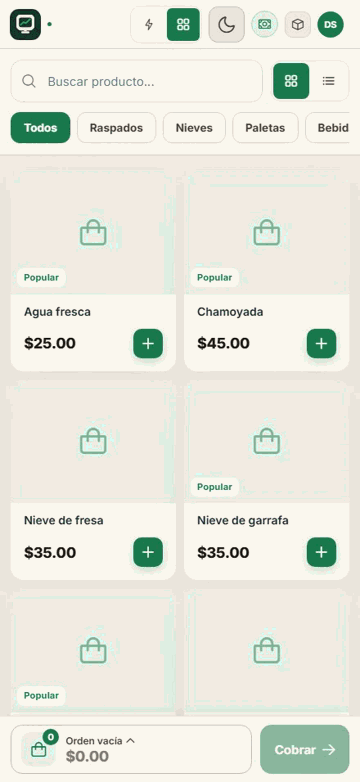
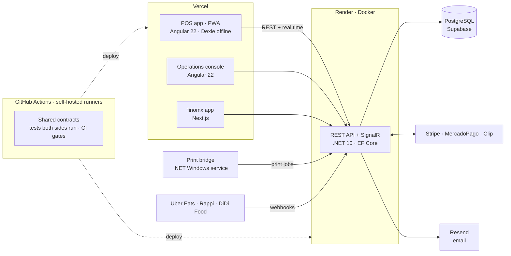

# Hi, I'm Jesús Murúa 👋

**Senior Full-Stack Developer & Tech Lead** based in Hermosillo, Mexico.
10 years building enterprise systems and SaaS products with Angular and .NET — backend, frontend and design, end to end.

---

## What I'm building right now

<p align="center">
  
</p>

**Fino** is a multi-tenant SaaS platform that runs the daily operation of small businesses across 120+ business types
in four families: food & beverage, quick service, retail and services. I designed and built it from scratch as its
sole developer.

**[finomx.app](https://finomx.app)** · **[app.finomx.app](https://app.finomx.app)**

<p align="center">
  
</p>

**What it does**

- **One configurable core** that every business type shares — point of sale, cash register shifts, inventory,
  purchasing, customers and credit, multiple branches and reports — adapted to each business type and plan,
  resolved server-side per tenant
- **In-depth modules** for the industries that need them: restaurants (table service, waiters, a real-time kitchen
  display, reservations), made-to-order businesses such as bakeries (orders with deposits, production capacity,
  recipe costing), workshops and service businesses (work orders, appointments, memberships, access control), and
  tire shops (fleet tire tracking, roadside service with an offline app for technicians)
- **Offline-first PWA**: sales keep working without internet and sync without duplicates when the connection returns
- **Integrations**: Stripe subscriptions, MercadoPago and Clip card terminals, Uber Eats · Rappi · DiDi Food orders,
  and thermal printing over Web Bluetooth or a Windows bridge service

**How it fits together**



**How it's engineered**

- Six repositories — API, POS app, operations console, marketing site, Windows bridge and a shared repo whose
  **contract tests both client and server run**, so a rule that lives on both sides cannot drift apart
- Integration tests against a real PostgreSQL, Angular unit tests, Playwright end-to-end flows and mutation testing
- Custom CI gates that block regressions before merge, including query-count limits that catch N+1 queries
- Protected `main`: every change reaches production through a pull request, and each deploy is verified by commit
- Developed with AI coding agents (Claude Code), backed by those tests and gates

**Tech stack**

```
Backend   │ .NET 10 · ASP.NET Core · EF Core · PostgreSQL (Supabase) · SignalR · Clean Architecture
Frontend  │ Angular 22 · PrimeNG 22 · TypeScript · Signals · RxJS · Dexie.js (offline-first PWA)
Landing   │ Next.js
Hardware  │ Web Bluetooth · ESC/POS · .NET Windows bridge · Web Push
Infra     │ Vercel · Render (Docker) · Supabase · Cloudflare · GitHub Actions (self-hosted runners)
Payments  │ Stripe · MercadoPago · Clip
Delivery  │ Uber Eats · Rappi · DiDi Food
Testing   │ xUnit + real PostgreSQL · Karma · Playwright · Vitest · contract tests · mutation testing
AI        │ Claude Code (AI coding agents)
```

---

## Previous work — Xemble Technologies (2021–2026)

**CleanPRO**, an enterprise facility management system for CBRE government and commercial clients (hospitals,
military bases, schools). Stack: .NET 9 · Angular 18 · SQL Server · Azure.

- **97% faster plan generation** — from ~1 hour to ~2 minutes for 3,500+ rooms; the root cause was .NET Gen2 garbage
  collection pressure, not I/O
- **40% smaller production payloads** — replaced full entity eager-loading with targeted projections
- **Floor Care Planner** — designed the UX from scratch and led the implementation: reschedule logic by date, team
  and shift, team capacity algorithms, real-time polling
- **Legacy migration** to .NET 9 + Angular 18, with the coding standards and CI/CD pipeline the team adopted
- **Azure Form Recognizer + OCR** to extract data from scanned field forms, with human review below a confidence
  threshold
- Full **i18n** across 8+ modules, and mentoring of developers on backend and frontend

---

## Certifications

- Angular Intermediate & Basic — HackerRank (2026)
- C#, ASP.NET, MSSQL, Angular, JavaScript — Verified by Talently (2024)

---

## Connect

[](https://www.linkedin.com/in/jesus-murua)
[](mailto:jesusmuruar@gmail.com)
